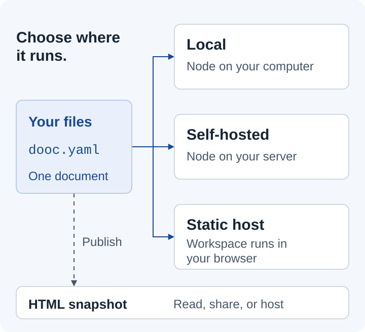

# Orchestrate native resources as a document.

dooc composes text, diagrams, data, and code into one document. Each resource keeps its native format.
Read and edit the same files your tools use and Git tracks.


## Install

| Method   | Command                                                                                      |
| -------- | -------------------------------------------------------------------------------------------- |
| npm      | `npm install -g @dooc-dev/dooc`                                                              |
| curl     | `curl -fsSL https://github.com/dooc-dev/dooc/releases/latest/download/install.sh \| sh`      |
| mise     | `mise use -g github:dooc-dev/dooc@latest`                                                    |
| Homebrew | `brew tap dooc-dev/dooc https://github.com/dooc-dev/dooc && brew install dooc-dev/dooc/dooc` |

npm requires Node.js 22 or later.

## Start a project

```sh
mkdir my-docs && cd my-docs
dooc init
dooc editor
```

Open the printed URL to start editing. Use `dooc viewer` for read-only access. Both open `dooc.yaml` in the current directory.

## Hosting



## Documentation

Guides and command options: [docs.dooc.dev](https://docs.dooc.dev) ([source](dooc-docs/contents/md/index.md)).

## License

[MIT](LICENSE)
