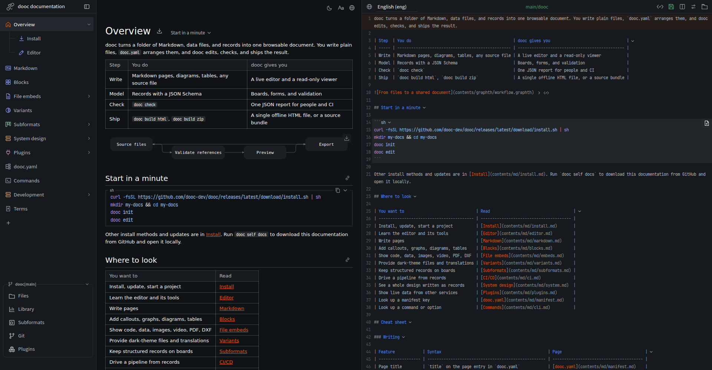

# dooc



dooc turns a folder of Markdown, data files, and schema-backed records into one browsable document.
`dooc.yaml` arranges the files; dooc edits, checks, and ships them as a single HTML file.

## Install

| Method   | Command                                                                                      |
| -------- | -------------------------------------------------------------------------------------------- |
| npm      | `npm install -g @dooc-dev/dooc`                                                              |
| curl     | `curl -fsSL https://github.com/dooc-dev/dooc/releases/latest/download/install.sh \| sh`      |
| mise     | `mise use -g github:dooc-dev/dooc@latest`                                                    |
| Homebrew | `brew tap dooc-dev/dooc https://github.com/dooc-dev/dooc && brew install dooc-dev/dooc/dooc` |

## Documentation

```sh
dooc self docs
```

## License

[MIT](LICENSE)
