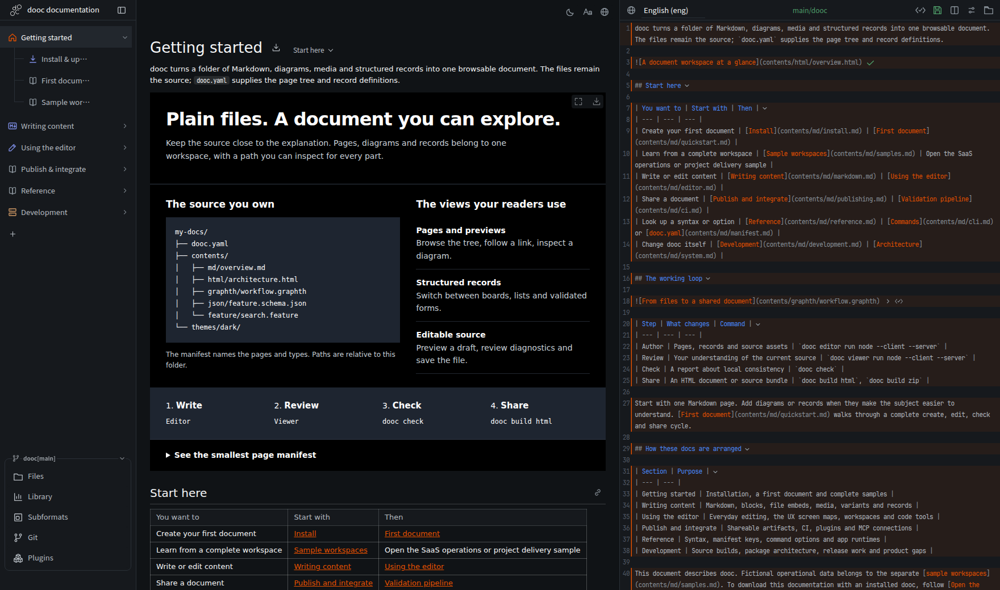

# Orchestrate native resources as a document.

dooc orchestrates text, diagrams, data, code, and any other resoruces into one document.



## Install

| Method   | Command                                                                                      |
| -------- | -------------------------------------------------------------------------------------------- |
| npm      | `npm install -g @dooc-dev/dooc`                                                              |
| curl     | `curl -fsSL https://github.com/dooc-dev/dooc/releases/latest/download/install.sh \| sh`      |
| mise     | `mise use -g github:dooc-dev/dooc@latest`                                                    |
| Homebrew | `brew tap dooc-dev/dooc https://github.com/dooc-dev/dooc && brew install dooc-dev/dooc/dooc` |

npm requires Node.js 22 or later.

## Start a project

```sh
mkdir my-docs && cd my-docs
dooc init
dooc editor
```


## Hosting

Run an editor or read-only reader with a Node workspace:

```sh
dooc editor run node --client --server --project ./dooc.yaml --port 3000
dooc reader run node --client --server --project ./dooc.yaml --port 3000
```

Run either command, then open `http://localhost:3000/client/`. For remote hosting, use a reverse proxy and set `--server-url wss://docs.example.com/server` and `--client-origin https://docs.example.com` to match your public host.

Build an editor or reader for static hosting, with the workspace running in the browser:

```sh
dooc editor build web --client --server --out ./public-editor
dooc reader build web --client --server --out ./public-reader
```

Host either output directory at the site root. Route document paths to `index.html`; missing `/assets/*` and `/api/*` requests must return 404. Open a workspace in the browser after deployment.

See [App runtimes](dooc-docs/contents/md/runtimes.md) for component options and reverse proxy setup.

## Documentation

Guides and command options: [docs.dooc.dev](https://docs.dooc.dev) ([source](dooc-docs/contents/md/index.md)).

## License

[MIT](LICENSE)
