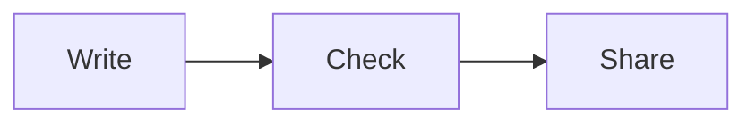

Seven fence labels render as blocks instead of code. Each one can be written inline as a code fence or kept in a file with the same extension and embedded. Text after the label is the caption.

| Label      | File ext    | Renders            | Caption |
| ---------- | ----------- | ------------------ | ------- |
| `callouth` | `.callouth` | Callout box        | yes     |
| `graphth`  | `.graphth`  | Relationship graph | yes     |
| `schemath` | `.schemath` | ER diagram         | yes     |
| `termth`   | `.termth`   | Term definition    | no      |
| `mermaid`  | `.mermaid`  | Mermaid diagram    | no      |
| `csv`      | `.csv`      | Table              | yes     |
| `tsv`      | `.tsv`      | Table              | yes     |

## callouth

Paragraphs and lists with text, code, and links.

```callouth Before you publish
Run `dooc check` first.

- Confirm links and file references.
- Review the page in both themes.
```

From a file:


## graphth

| Line                  | Meaning                     |
| --------------------- | --------------------------- |
| `[id]: label`         | Node                        |
| `[id]: label @region` | Node inside a framed region |
| `[a] -> [b]`          | Solid directed edge         |
| `[a] --> [b]`         | Dashed directed edge        |
| `[a] -- [b]`          | Undirected edge             |
| `[a] -> [b]: label`   | Edge label                  |
| `[a] -> [b] -> [c]`   | Chain, without labels       |
| `# text`              | Note                        |

```graphth From draft to release
[draft]: Draft @Write
[check]: Check @Write
[build]: Build @Share
[reader]: Reader @Share

[draft] -> [check]: dooc check
[check] -> [build]
[build] --> [reader]: bundle.html
[draft] -- [reader]
```

From a file:


## schemath

| Line                    | Meaning                             |
| ----------------------- | ----------------------------------- |
| `table:`                | Table; fields are indented below it |
| `field: pk`             | Primary key                         |
| `field: fk(table)`      | Reference; `fk(a\|b)` for a union   |
| `field: fk[](table)`    | Array of references, drawn dashed   |
| `field: enum("a"\|"b")` | Enum                                |
| `field: string`         | Scalar type                         |
| `pk(a, b)`              | Composite primary key               |
| `unique(a, b)`          | Unique constraint                   |
| `### label`             | Group; framed when it has a label   |

```schemath Authors and documents
### Content
authors:
  id: pk
  name: string

documents:
  id: pk
  author_id: fk(authors)
  tags: fk[](tags)
  state: enum("draft"|"published")

### Taxonomy
tags:
  id: pk
  label: string
  unique(label)
```

From a file, the model behind [Linked records](contents/md/records.md):


## termth

A YAML object with `name`, `definition`, and optional `description`. The fence takes no caption.

```termth
name: "Manifest"
definition: "The dooc.yaml file that lists pages, record types, and display settings."
```

From a file. Link to a term file with `[workspace](contents/termth/workspace.termth)`: [workspace](contents/termth/workspace.termth).


## mermaid



From a file. This one has a dark [theme variant](contents/md/variants.md):


## csv and tsv

Columns are numbered and every row is data. Quote a cell that contains the separator.

```csv Release readiness
Area,Owner,Status
Editor,Alice,Ready
"Cards, embeds",Bob,In review
```

From files: see [File embeds](contents/md/embeds.md#tables).

## Markdown

A Markdown file can be embedded as a fragment.


