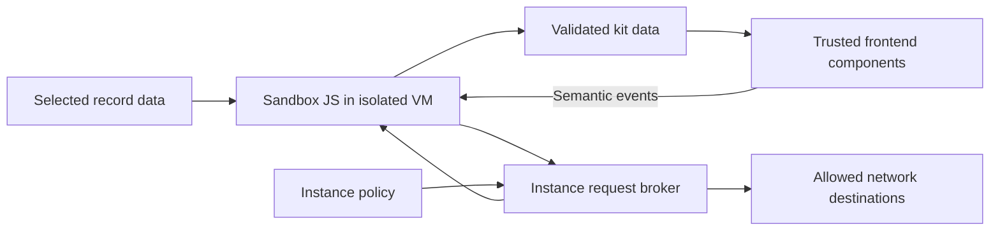

Status: **Architecture accepted; not implemented.** The plugin kinds are `sandbox` and `host`; the declarative display API is `kit`. This page is the design reference. [Plugins](contents/md/plugins.md) and [Write a plugin](contents/md/plugin-dev.md) describe the current trusted service-plugin runtime, which has not yet acquired these isolation guarantees.

## Decision

Separate plugin execution authority from its display API:

| Name | Meaning | Installation | Authority |
| --- | --- | --- | --- |
| `sandbox` | Untrusted JavaScript in an isolated VM; produces validated `kit` data | Runtime package installation; the user-uploaded marketplace path | Instance state and explicitly brokered I/O |
| `host` | Trusted frontend JavaScript/TypeScript using ordinary DOM, CSS and application components | Explicit inclusion in the dooc frontend build | The same browser/application authority as dooc |
| `kit` | The component data and semantic event contract implemented by dooc | Ships with the frontend; trusted host extensions may add components | Its guest-facing operations retain the calling sandbox instance's policy |

`kit` is an API, not a third plugin kind. A sandbox author can use JavaScript or compile TypeScript during packaging; Rust and Go are not required. A host plugin need not express its own UI through kit. Host means the dooc frontend application, not an OS binary or automatic access to server APIs.

Use a JavaScript VM in a trusted Worker as the initial browser architecture for sandbox plugins. A Wasm-based interpreter such as [QuickJS-Emscripten](https://github.com/justjake/quickjs-emscripten) is the first implementation candidate. The package and version remain unselected until the prototype verifies isolation, resource limits and cost. An iframe is not the default execution boundary, and plugin authors do not need a direct-Wasm artifact.

## Execution and display

The loader evaluates guest source only inside the VM. Expose selected data, kit output and the instance broker; do not expose native browser objects, `fetch`, WebRTC, storage, Node APIs or a host module loader. Dependencies are bundled into the sandbox package and evaluated under the same boundary. A Worker alone has browser I/O APIs, and Node's [`vm` module](https://nodejs.org/api/vm.html) is not a security boundary for untrusted code. Loader code and VM bindings remain trusted.

Start kit with the existing `PluginBlock` vocabulary and validation. Transfer bounded data and action IDs, never live host objects, arbitrary HTML/CSS, executable callbacks or guest-selected browser constructors. Validate total output size, depth, node count and event payloads. Markdown, images, fonts and other automatic resource loads must use controlled host paths and the instance's network policy. Navigation links require an explicit user action; guest output cannot trigger navigation by itself.

Keep scrolling, focus, text entry, CSS animation and built-in pan/zoom in the frontend. Send semantic events when plugin logic needs to run, batch its resulting view updates, and retain unchanged DOM. Do not put a VM round trip on every animation frame or pointer movement. Add graph or schema components when their formats require them, rather than implementing a generic remote DOM.

A host plugin may expose an additional kit component through a validated data/event contract. Any I/O triggered on behalf of a sandbox caller must retain that caller's policy. Do not expose generic host function invocation or pass credentials or browser objects back to the VM. The sandbox guarantee depends on dooc and all included host extensions being trusted.

## Instance policy

A sandbox instance is one intentionally shared data/account/state boundary. It is not the plugin package name or necessarily one card. A board containing many records may share an instance; independent embeds and accounts remain separate even when they use the same package and identical allowlists.

The owner-controlled `dooc.yaml` declares one network destination allowlist per instance and, when needed, an instance-private storage namespace. Omitted permissions deny network and persistent storage. Storage permission does not grant workspace or filesystem access. Keep configuration coarse: no permissions per function, field, DOM method or HTTP endpoint. A no-I/O view and a network-enabled connector require separate instances if they need different authority.

The execution host must authorize the requested policy. Package metadata, downloaded repositories, included manifests and untrusted edits cannot expand it independently. Account identity is selected by the host; tokens remain in the trusted credential service and never enter guest memory, document data or exports. Granting a domain permits sending data there; it does not make a plugin trustworthy or prove its operations are read-only.

Each independent instance gets a separate VM runtime/heap and a dedicated channel bound to its policy. Guest-supplied instance IDs cannot select another channel's permissions. Replace the execution environment and revoke pending requests/results when the package, permissions, account or workspace changes. Dispose channels, listeners, timers and guest state together. Share immutable engine/package bytes where supported, not mutable guest state or native object references.

Apply VM memory/stack limits, computation deadlines, output limits and bounds on queued updates and concurrent requests. Begin with independently terminable Workers for active instances. Use an external watchdog and [Worker termination](https://developer.mozilla.org/en-US/docs/Web/API/Worker/terminate), because a timer inside a busy Worker cannot interrupt it. A shared Worker pool would also share scheduling and termination impact, so it requires measurement before adoption. VM limits do not bound all frontend or browser memory.

## Network enforcement

All sandbox network requests cross the instance broker. The plugin owns service-specific request and response logic; dooc owns transport authorization and credentials. Enforce exact normalized DNS names over HTTPS on the default port. A domain entry grants no implicit subdomains, wildcards, arbitrary ports or additional protocols. Missing or empty allowlists deny requests.

Keep redirect rejection. Apply DNS/public-address checks at the actual connection so an allowed name cannot reach loopback, private networks or metadata services. Bound response sizes, request concurrency and timeouts. A browser-only host that cannot enforce the transport requirements must use a suitable broker or leave the capability unavailable. Authentication endpoints and token attachment must also follow host policy; guest input cannot redirect credentials to another permitted destination.

Provider account scopes and existing reader/edit restrictions still apply. Method filtering alone does not establish semantic read-only behavior. A kit component cannot bypass these checks through resource URLs, host callbacks or automatic navigation.

Host plugins have the browser and application authority of dooc. They may use the broker for consistency, but the sandbox allowlist cannot constrain their direct browser APIs. Browser protections and server authorization still apply. A host plugin does not automatically receive filesystem access or a server credential; server operations must remain authorized by the server.

## Distribution and lifecycle

The user-uploaded marketplace path accepts sandbox artifacts only. Reuse bounded archive validation and package revision identities, without executing installation scripts or build hooks. Publishing or installing a package does not grant its requested destinations. A package cannot switch to the host loader by changing its kind label.

Host plugins are ordinary dependencies selected in trusted frontend build configuration. Adding or changing one requires rebuilding the dooc frontend bundle. Documents and marketplace packages cannot add host imports, module URLs or build configuration. An existing build may use lazy chunks of its selected code. Here, build means the frontend distribution build; exporting a document with `dooc build` does not make its code trusted.

Instantiate sandbox logic near the viewport, retain focused or actively edited instances, and bound the number of active instances using measured limits. Keep static output and reserved dimensions for unloaded or failed instances. Disposal ends execution; cooperative suspension alone does not enforce a resource limit. Do not merge independent authority boundaries to reduce memory use. Built-in static callouts and terms should not require a VM on every repaint.

## Subformats and publishing

Subformats own record parsing and schemas. A renderer selects presentation through kit or a host renderer already included in the build. Selection cannot install host code, change a plugin's trust class or take over a parsing extension. Storage parsing, schema validation, source identity, reference extraction, filtering and writes remain dooc responsibilities.

| Existing format | Structured record direction | Behavior to preserve |
| --- | --- | --- |
| `callouth` | Optional title and Markdown body | Body restrictions, captions, links, rebasing and reference checks |
| `termth` | Name, definition and optional description | Field validation, term indexing, links and anchors |
| `graphth` | Nodes, edges and regions | Edge kinds, labels, structural checks and static diagrams |
| `schemath` | Tables, fields and constraints | Keys, references, groups, validation and static diagrams |

Retain legacy parsers as adapters and preserve existing extensions and fences. New records can use YAML, JSON or TOML and dotted subformat fences. A generic form must not silently rewrite an existing DSL. Drawing the same picture is not sufficient to replace a format's compiler semantics.

Keep static HTML/SVG fallbacks for failed or missing plugins, printing and JavaScript-disabled readers. Offline single/split HTML includes the required VM, sandbox assets, kit and already selected host code; service calls still require an authorized transport. Source ZIPs carry no personal grants or credentials. Static builds may evaluate sandbox logic only under the same isolation, policy and limits, and must not import untrusted build hooks. A fetched snapshot and permission to contact its service are separate.

## Existing code and compatibility

| Existing code | Reuse |
| --- | --- |
| `plugins/src/blocks.ts`, `plugins/src/view.ts`, frontend plugin rendering | Kit vocabulary, validation, escaping and theme behavior |
| `packages/engine/src/core/extension-package.ts`, server extension management | Bounded packaging, revision identity and lifecycle patterns |
| Server plugin request/OAuth helpers and compiler public-file transport | Credentials, redirect rejection and transport checks; complete the instance broker boundary |
| Existing frontend builds and component mount/disposal patterns | Explicit host integration and trusted kit display |
| Subformat parsing and compiler reference checks | Record semantics and compatibility during renderer migration |

Current ZIP plugins and reader modules execute trusted server imports. Their constrained request helper does not prevent other Node I/O. They are not automatically sandbox plugins, and they are not the new host frontend API. Preserve current loading restrictions until their code is actually migrated behind the VM and broker. No current package may gain a sandbox label without that change.

## Alternatives and evidence

| Approach considered | Decision |
| --- | --- |
| Same-page Web Components / Shadow DOM | Suitable for trusted kit or host UI; not a code-authority boundary |
| Untrusted iframe with sandbox and CSP | Not the default; the tested policy did not enforce complete network denial |
| Direct-Wasm plugin artifact | Not required; it adds a toolchain/ABI requirement for plugin authors |
| Native JavaScript compartments | Not selected for the first prototype; resource-limit and integration behavior would need separate validation |

The local headless Chromium 149 experiment denied parent/sibling DOM access and the tested fetch/image/CSS requests, but still emitted WebRTC STUN traffic with `default-src 'none'` and `connect-src 'none'`. The tested `webrtc 'block'` directive was unrecognized. Its presence in the [CSP working draft](https://www.w3.org/TR/CSP3/#directive-webrtc) does not establish browser support. This is evidence against relying on that tested iframe policy, not a claim about every browser configuration.

The fixture used loopback receivers and Playwright with the browser's OS sandbox disabled. It did not test OS compromise resistance, other browser engines or mobile devices. Its iframe/Shadow DOM timings do not measure VM startup, real interaction latency or a sandbox speedup. Detailed investigation output remains outside the product guides; no VM performance result has been established.

## First implementation and open details

1. Prototype one sandbox `.note` renderer using existing kit blocks, with two independent instances of the same package and different destination allowlists.
2. Bundle one host renderer through the existing frontend build. Verify that document/package data cannot import host code, select a more privileged loader or invoke unexposed host functions.
3. Verify policy revocation, account separation, denied direct I/O, redirect/private-address rejection, private storage, oversized input/output and non-yielding code. Preserve keyboard/focus behavior, theme/data updates, static/offline output and legacy references.
4. Measure startup, per-instance memory, serialization and interaction latency with many records and representative computation. Select the VM package/version and resource thresholds from those results.

The architecture and names are settled. Exact manifest keys, renderer-to-instance binding and the versioned kit contract must be specified with the prototype. Earlier sketches such as `system.plugin_instances` and `layouts.renderer` are not supported configuration. Building a marketplace service, adding a generic DOM protocol, pooling VMs and migrating all four formats are outside the first implementation.
