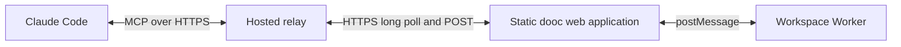
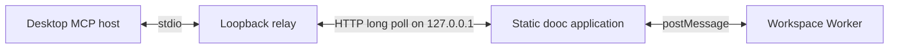

A static dooc web application can expose its open browser workspace to a remote MCP client through a hosted relay. End users run Claude Code and open the website; they do not install or start a local dooc server, bridge, or browser extension.

Both network connections use HTTPS. Claude Code uses Streamable HTTP at the relay's `/mcp` endpoint. The browser receives work through bounded HTTPS long polls and posts results back. WebSocket is not required. The static application and relay can use different domains.



## Desktop connections

Relay is a built-in dooc feature, started with `dooc mcp relay --stdio` for local MCP hosts. The Desktop extensions bundle the same implementation generated from the dooc source tree, so users do not install dooc separately. There is no separately published relay package.



Build a Desktop-compatible site without a hosted relay:

```sh
dooc editor build web --all --out ./public-editor
```

Install the Desktop integration once. Ask the assistant to connect to the site's URL. Its `connect_browser` tool returns a private connection link with a temporary loopback port and browser-only credential. Open that link on the same computer, select a workspace, and click **Connect Desktop** in the MCP dialog. Grant browser local-network permission when prompted. Read-only access is the default; the assistant requests `read_only: false` only for user-requested edits.

The browser removes the credential fragment from its address bar before opening the workspace. Desktop credentials are kept in memory, not saved by the Web client. The listener accepts only the chosen website origin, and its public pairing endpoint is disabled. No publisher relay, user terminal command, manually started process, or dooc installation is needed on the Desktop machine. Claude's `.mcpb` uses its bundled Node runtime; a Codex native plugin artifact includes its runtime. The Codex source checkout uses Node.js 22 or later for development.

Each Desktop MCP process owns one workspace connection. A new `connect_browser` call replaces the previous connection; distinct Desktop sessions use distinct ports. Keep both the tab and Desktop session open. Request a new connection link after reloading the page or restarting Desktop. Cloud-hosted execution cannot use the user's loopback listener. Browser permission and mixed-content policies vary, so supported browsers need platform testing.

The integration sources live in the private `dooc-dev/dooc-extension-claude-desktop` and `dooc-dev/dooc-extension-codex-desktop` repositories. Each repository includes a generated `server/relay.mjs` from dooc. Run `pnpm run build:relay` in the dooc source tree to generate `dist/mcp-relay.mjs`, then update the bundled file and run the extension tests. The implementation is maintained only in dooc; the extension repositories own host packaging and settings.

## Hosted deployment

The publisher runs the relay once, independently of the static files. A static host alone cannot receive MCP POST requests or connect those requests to an open browser. HTTPS may terminate at a reverse proxy or at the relay using a certificate and key.

```sh
# Set a persistent random secret in the hosting environment, not in the web build.
export DOOC_MCP_RELAY_SECRET="<at-least-32-random-characters>"
dooc mcp relay --public-url https://relay.example.com --client-origin https://example.com --port 3000

# Build the files served by example.com.
dooc editor build web --all --relay-url https://relay.example.com --out ./public-editor
```

The relay listens on loopback by default. Forward HTTPS traffic to its HTTP listener and preserve the public Host header. For direct TLS, pass `--tls-cert <pem>` and `--tls-key <pem>` together; `--host <address>` selects the listening address. The proxy must allow long polls of at least 30 seconds and tool requests of at least 65 seconds. There is no WebSocket upgrade or SSE buffering requirement.

Use `viewer` instead of `editor` for a read-only Worker and tool catalog. Web `--mcp` requires `--client` and `--server`. Add `--relay-url` for a hosted relay; it includes a browser connector rather than opening another listener. The relay URL is public configuration. Credentials are created after deployment and are never embedded in build output. HTTPS is required except for loopback HTTP during development.

## Connecting through a hosted relay

Open a workspace, open its MCP connection dialog, and enable the connection. The relay issues separate browser and MCP credentials for that workspace. Copy the displayed command into the terminal:

```sh
claude mcp add --transport http dooc https://relay.example.com/mcp \
  --header "Authorization: Bearer <workspace-token>"
```

The browser retains the connection credentials for this site, relay, workspace, and access mode. Reopening the saved browser workspace reconnects automatically. A saved active browser workspace opens automatically when the web application loads. Local folders still require the browser's folder selection and permission; their handles are not silently restored. Git credentials remain in memory and are not saved by the relay connector.

The first version uses an accountless, workspace-scoped bearer credential. A shared anonymous URL cannot identify the correct user's workspace. OAuth and account management are outside this implementation. Treat the copied command as a credential and keep it out of repositories and shared logs. Disconnecting stops browser execution and removes the saved pairing; reconnecting creates a new pairing. Rotating the relay secret invalidates all existing credentials.

## Responsibilities and failure behavior

| Component | Responsibility |
| --------- | -------------- |
| Relay | Authenticate both sides, answer MCP initialization and tool discovery, route each call to its paired browser, enforce deadlines and bounded queues |
| Browser connector | Restore an enabled pairing, receive work over HTTPS, call the selected Worker, post the result, and show connection status |
| Workspace Worker | Validate tool arguments, enforce read-only access, serialize operations with UI edits, resync storage, and persist changes |

A pairing stays attached to one workspace. Changing the active editor pane does not retarget it. Only one browser tab may execute a pairing at a time; another tab waits until the previous connection releases ownership or expires.

MCP initialization and tool discovery work without an online tab. Tool calls fail clearly while the workspace is offline. Each call has a deadline. Delivered calls are not replayed after a lost response, reconnect, or relay restart; a failed write may already have completed, so read the current content before retrying it. Pending requests and results are transient and are not stored as document copies. The relay can see the requests and results it forwards.

The browser uses a 25-second long poll. Idle ownership expires after 35 seconds without contact; an executing request has a 60-second deadline. Messages are limited to 8 MiB, including JSON/base64 overhead. One relay process holds the active connections; multiple replicas require routing a pairing to the same process and are not supported by this initial deployment. Keep the signing secret stable across restarts to preserve registration; in-flight requests are still lost.

The web tool catalog shares document, figure, file, font-list/removal, validation, and source-export tools with Node. Node-only build, Git/history, external font import, and figure import from an OS path are not advertised. Figure text and file uploads remain available. Viewer MCP rejects mutations in the Worker as well as at the relay.

An open tab is not an always-running server. Browser suspension, tab discard, closing the page, or device sleep makes the workspace unavailable. Reconnection resumes future requests; it does not resume an interrupted mutation. Service Workers do not remove this lifecycle restriction.

## References

- [Claude Code remote MCP and bearer authentication](https://code.claude.com/docs/en/mcp)
- [MCP Streamable HTTP transport](https://modelcontextprotocol.io/specification/2025-11-25/basic/transports)
- [Browser fetch requests](https://developer.mozilla.org/en-US/docs/Web/API/Fetch_API/Using_Fetch)
- [Browser page lifecycle](https://developer.chrome.com/docs/web-platform/page-lifecycle-api)

- [Claude Desktop MCP bundle format](https://github.com/modelcontextprotocol/mcpb)
- [Codex local MCP plugins](https://developers.openai.com/plugins/deploy/desktop-only)
